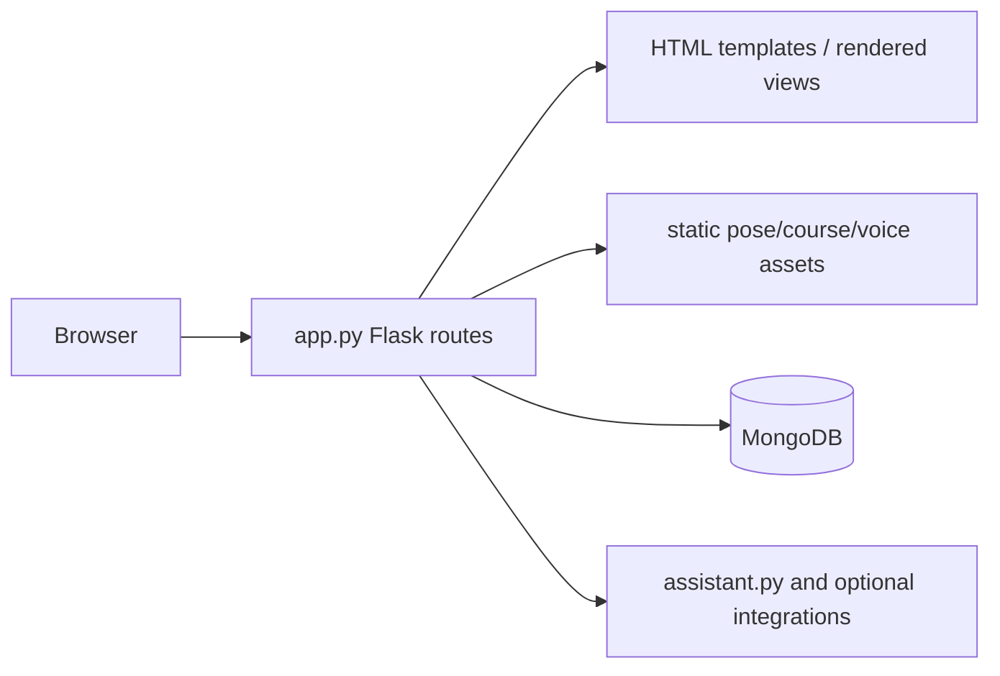

# AsanaMind

A Flask-based wellness and yoga assistant. The application serves HTML pages and static practice assets, maintains user/session state, and integrates optional MongoDB-backed data and assistant functionality.

## Architecture



`app.py` is the primary web entrypoint. `assistant.py` contains assistant behavior; `main.py`/`main1.py` and `start_sunday.py` are supporting execution paths. `static/` stores pose cues, courses, practice flow, and voice knowledge.

## Setup

```bash
python -m venv .venv
. .venv/bin/activate
pip install -r requirements.txt
# set local values from .env.example
flask --app app run --debug
```

For production, the included Procfile uses `gunicorn app:app --workers 1 --threads 4 --timeout 60`. The `pyproject.toml` also lists optional speech/browser tooling.

## Data and workflow

A request enters Flask, session/authentication logic selects the user experience, and views consume the static pose/course knowledge. MongoDB is used for application data when configured; `asana_status.json` and related status files support the project workflow.

## Deployment

Provide `MONGODB_URI`/database settings and any integration credentials through the hosting provider. Use HTTPS, a strong Flask secret, secure cookies, and a managed MongoDB deployment.

## Testing and limitations

No complete automated test command is declared. Verify registration/login, practice flow, assistant responses, and database failure behavior manually. Browser speech, camera, and audio capabilities vary by device; assistant and notification integrations are optional and require separate credentials.

## Security and operations

- Keep credentials, database URLs, OAuth tokens, API keys, and signing secrets in environment variables; never commit them.
- Validate and constrain uploaded files and user input at the server boundary, and enable HTTPS in production.
- Review dependency updates and rotate any credential that has appeared in repository history.

## Testing

The repository currently has no comprehensive automated test suite unless noted above. Before production changes, add tests for authentication/authorization, validation failures, persistence errors, and the primary user workflow.

## Limitations and roadmap

This is an actively evolving project. Production hardening, observability, rate limiting, backup/retention policy, and accessibility/performance validation should be completed before handling sensitive or high-volume workloads.

## License

See the repository license file and package metadata for the authoritative terms.
