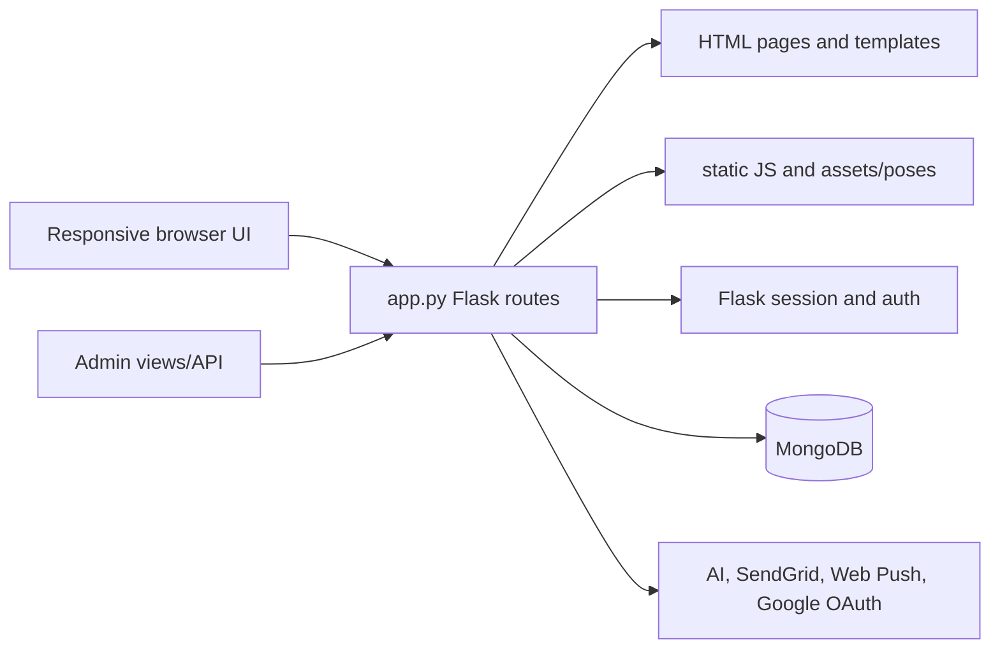

# AsanaMind


AsanaMind is a Flask-based yoga and wellness web application. It combines guided pose practice, browser media features, accounts and progress tracking, an optional AI assistant, certificates, web push reminders, and an administrative dashboard.

> **Status:** Active prototype. Review deployment, privacy, accessibility, and security controls before using it with real health or identity data.

## Demo and assets

- **Hosted demo:** no verified public URL is configured in this repository; run locally with the instructions below.
- **Visual assets:** [pose library](assets/poses/), [practice scripts](static/practice-flow.js), [pose cues](static/pose-cues.js), and [voice knowledge](static/voice-kb.js).

## Architecture and request flow



A browser request enters `app.py`, which serves the HTML experience and JSON endpoints. Session and account data are persisted in MongoDB when configured. Optional integrations are enabled only when their environment variables and dependencies are available.

## Features and API surface

- Account flows: `POST /register`, `POST /login`, `POST /auth/google`, `GET /logout`.
- User data: `GET /api/profile`, `POST /api/complete_pose`, `/api/course-progress`, `/api/streak`, and `/api/preferences`.
- Assistant and sync: `POST /api/assistant`, `GET /api/commands`, and `POST /api/sync-history`.
- Certificates and notifications: `/api/certificate`, `/api/certificates`, `/api/certificate/email`, and `/api/push/*`.
- Admin operations are under `/admin/*` and `/api/admin/*` and require the application’s admin checks.

The route decorators in `app.py` are the source of truth for request methods, payloads, and authentication requirements. Do not treat this list as a versioned external API contract.

## Local setup

Python 3.11+ is expected.

```bash
python -m venv .venv
. .venv/bin/activate                 # Windows: .venv\\Scripts\\activate
pip install -r requirements.txt
cp .env.example .env                # fill placeholders locally; never commit .env
flask --app app run --debug
```

Production-like startup is declared in `Procfile`:

```bash
gunicorn app:app --workers 1 --threads 4 --timeout 60
```

## Configuration

Copy `.env.example` and provide only the services you intend to use. `SECRET_KEY` and `MONGO_URI` are required for production. Google OAuth, SendGrid, VAPID push, and AI keys are optional integrations. `PORT` is used by the process entrypoint; `ASANA_MIND_URL` is used by the assistant helper.

Never put credentials in HTML, JavaScript, README files, screenshots, issue comments, or commits. Use the hosting provider’s secret store and rotate any credential that has appeared in repository history.

## Accessibility and mobile notes

The HTML declares viewport metadata and is designed for browser-sized practice sessions. Validate keyboard focus, readable contrast, reduced-motion behavior, touch target size, screen-reader labels, and camera/audio permission fallbacks on an actual phone and desktop browser before release. Camera, speech, audio, and push support vary by browser and user permission.

## Testing and limitations

There is no comprehensive automated test suite in the repository. The included CI check compiles Python modules and validates README-relative links. Before deployment, manually exercise registration/login, assistant fallback with no API keys, practice completion, database outage behavior, certificate flows, admin authorization, and mobile layouts.

## Security and privacy

See [SECURITY.md](SECURITY.md). This application handles account and wellness-progress data; configure HTTPS, secure cookies, rate limits, least-privilege database access, backups/retention, and monitoring before production use.

## License

No dedicated license file is present. Unless the owner adds explicit terms, treat the repository as all rights reserved.
